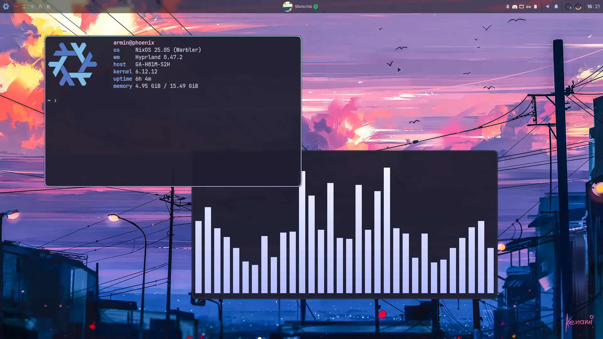
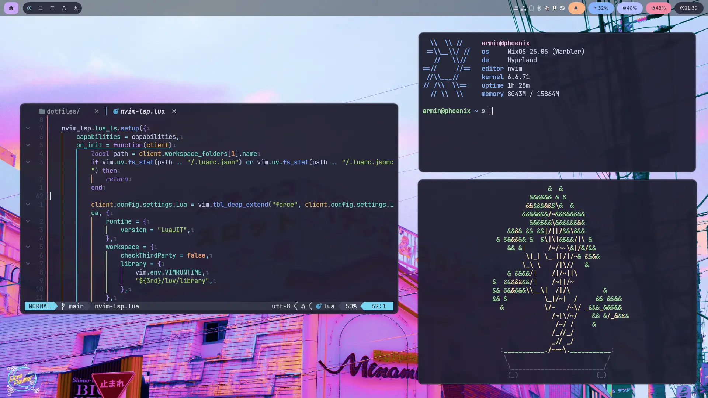

# dotfiles

## ISO

### Build
```sh
nix build "git+file:///$HOME/dotfiles?submodules=1#installer-iso"
```

### Test
```
qemu-system-x86_64 -enable-kvm -m 256 -cdrom result/iso/nixos-*.iso
```
### Notes
```
# Wifi Connection
nmtui
```

## preview



<details>
<summary> old versions </summary>



</details>

## Inspiration

- [fufexan](https://github.com/fufexan/dotfiles)
